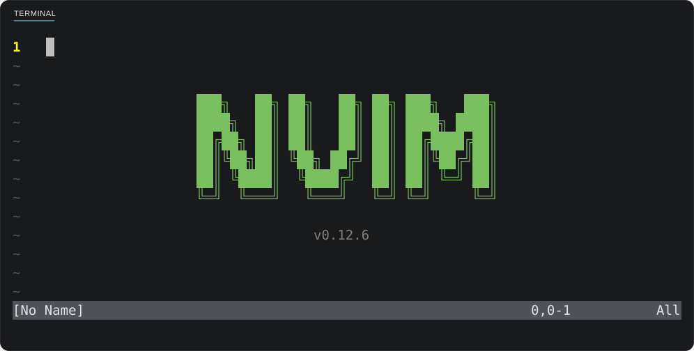

<p align="center">
  
</p>

<p align="center">
  <a href="https://neovim.io/"></a>
  <a href="https://www.lua.org/"></a>
  <a href="https://wiki.archlinux.org/title/Install_Arch_Linux_on_WSL"></a>
  
</p>

# nvim-config

A small Neovim configuration for Arch Linux in WSL2. It has no plugins, only two Lua files.
Neovim uses the background color of the terminal, so it matches VS Code.

## Install

1. If you have a configuration in `~/.config/nvim`, move it to a backup location:

   ```sh
   mv ~/.config/nvim ~/.config/nvim.bak
   ```

2. Clone this repository into `~/.config/nvim`:

   ```sh
   git clone https://github.com/sammcentee/nvim-config.git ~/.config/nvim
   ```

> [!TIP]
> To try this configuration and keep your own configuration, clone it into a different folder. Then start Neovim with `NVIM_APPNAME`:
>
> ```sh
> git clone https://github.com/sammcentee/nvim-config.git ~/.config/nvim-config
> NVIM_APPNAME=nvim-config nvim
> ```

## Settings

`init.lua` makes these changes:

- Neovim shows line numbers and relative line numbers.
- Yank, delete, and put use the system clipboard (`clipboard=unnamedplus`).
- Neovim uses full RGB colors in the terminal (`termguicolors`).
- Neovim does not paint a background color (`Normal guibg=NONE`). The background of the terminal shows instead, so Neovim matches VS Code. The text colors do not change.
- The number of the current line is bold yellow. This yellow is the same as the color of the VS Code cursor.
- The relative numbers above the cursor are muted blue. The relative numbers below the cursor are muted green.

## Colors

| Item | Color |
| --- | --- |
| Number of the current line (bold) |  |
| Relative numbers above the cursor |  |
| Relative numbers below the cursor |  |
| Welcome screen: NVIM wordmark |  |
| Welcome screen: version |  |

## Welcome screen

`lua/welcome.lua` replaces the default intro with a large green NVIM wordmark and a muted version line. The version comes from the installed Neovim.

The new screen shows only when Neovim starts with an empty buffer that has no name. The screen does not show in these conditions:

- You start Neovim with a file name, for example `nvim notes.md`.
- Neovim runs in VS Code (the vscode-neovim extension).
- Neovim runs without a user interface (headless).
- The terminal is less than 50 columns wide or less than 13 lines high.

The screen closes when you push a key. The screen also closes when you go to a different buffer or when the size of the terminal changes.

## Requirements

- Neovim. The version in use is 0.12.6.
- `win32yank.exe` on the `PATH`. Neovim uses this tool for the system clipboard in WSL. The Windows installation of Neovim includes it in `C:\Program Files\Neovim\bin`.

## Files

```text
~/.config/nvim
├── init.lua          editor settings and colors
├── lua/
│   └── welcome.lua   the NVIM welcome screen
└── assets/
    └── banner.svg    the picture at the top of this README
```
